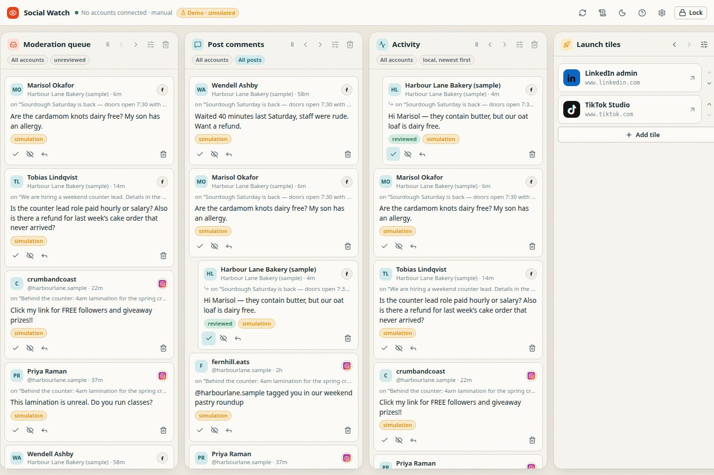
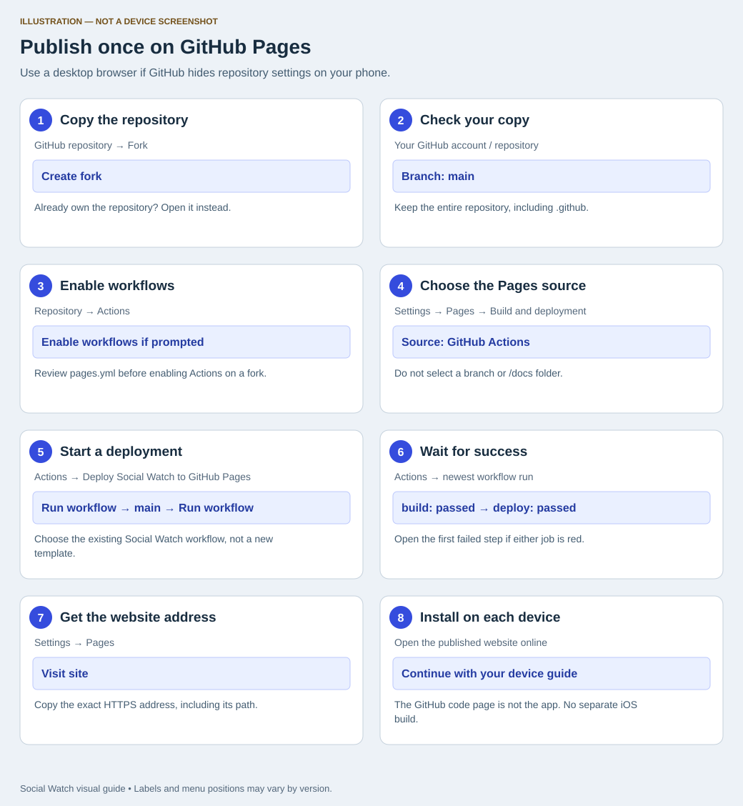
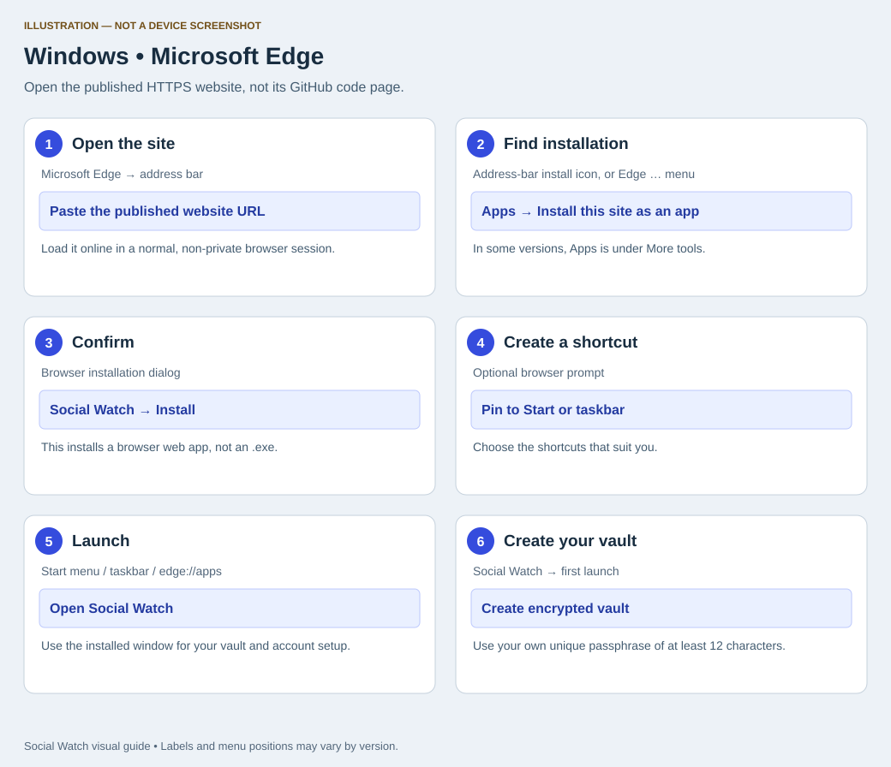
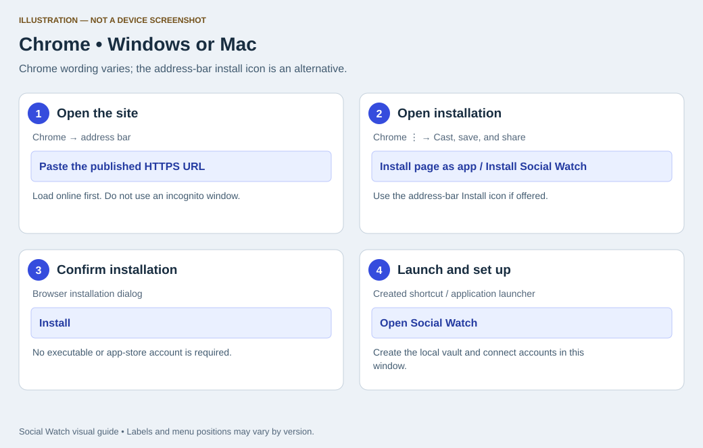
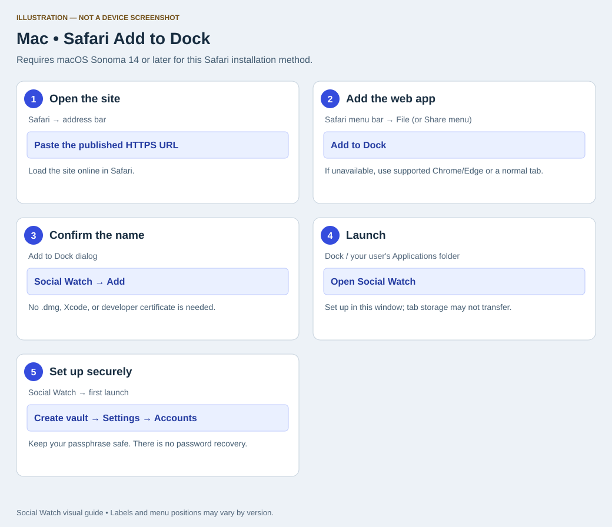
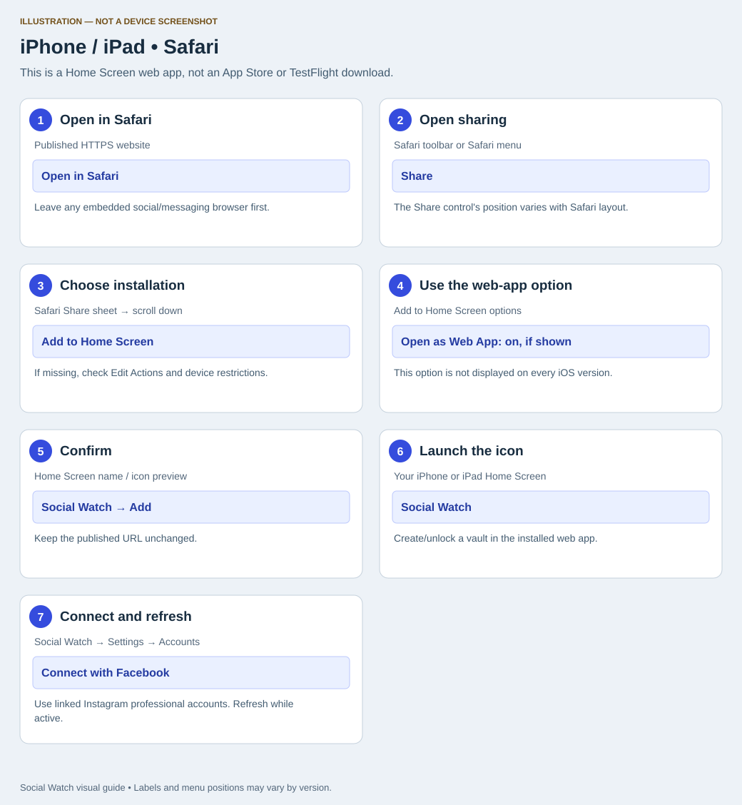

# Social Watch

A static, private social-moderation Progressive Web App for GitHub Pages.

Social Watch runs in your browser or in its own installed app window. It supports
Facebook Page and linked Instagram professional-account comment moderation.
LinkedIn and TikTok are launch links only, not imported feeds.

**There is no Windows `.exe`, Mac `.dmg`, iOS `.ipa`, or App Store download.**
Publish the website once, then install that same HTTPS website on each device.
End users do not need Git, Node.js, a terminal, Xcode, or an Apple developer account.

Your vault is encrypted and stored on the device. There is no runtime backend,
database server, cloud account sync, analytics, or notification service.

> **Background alerts have limits.** This fully static app cannot deliver reliable
> push notifications while closed or suspended. On iPhone/iPad, expect refresh only
> while the app is active. Installing the app or allowing notifications does not
> remove that restriction. See [notification setup](#notification-setup).

## Contents

- [Before installing](#before-installing)
- [Screenshots and illustrated walkthrough](docs/visual-guide.md)
- [Deploy the website to GitHub Pages](#deploy-the-website-to-github-pages)
- [Install on Windows](#install-on-windows)
- [Install on macOS](#install-on-macos)
- [Install on iPhone or iPad](#install-on-iphone-or-ipad)
- [First launch and account setup](#first-launch-and-account-setup)
- [Notification setup](#notification-setup)
- [Offline use, backups, and multiple devices](#offline-use-backups-and-multiple-devices)
- [Updates and uninstalling](#updates-and-uninstalling)
- [Run or build from source on Windows and Mac](#run-or-build-from-source-on-windows-and-mac)
- [Troubleshooting](#troubleshooting)

## Before installing

1. Use an up-to-date operating system and browser.
2. Get the **published website URL** from the person hosting Social Watch, or deploy
   your own copy using the next section.
3. Open that URL over **HTTPS** in a normal browser session, not private/incognito
   mode or an embedded browser inside another app.
4. Keep the full URL, including any repository subpath and trailing slash.
   A GitHub repository's code page is not the installed app's URL.
5. Have a strong passphrase ready. There is **no password reset or recovery**.

If the website is already published, skip deployment and go directly to your
device's installation section.

## See what to expect

The [visual walkthrough](docs/visual-guide.md) shows the **real app interface**
with fictional Harbour Lane Bakery Facebook and Instagram demo content, reply
composition, watchlist highlights, settings, and a phone-sized layout.



No live accounts were connected for these captures. LinkedIn/TikTok remain
**launch links only**, not imported feeds. Device and GitHub installation images
below are **labeled illustrations**, not screenshots of those systems.

## Deploy the website to GitHub Pages

This is a one-time task for the repository owner. The same website serves
Windows, Mac, iPhone, and iPad; you do not deploy a separate iOS build.

### First-time setup, step by step

You need a GitHub account. These steps use GitHub in a web browser; you do not
need to install Git or run commands.



1. **Create your own copy.** Open the
   [Social Watch repository](https://github.com/theBlow-AUS/SocialWatch) while
   signed in to GitHub. Select **Fork** near the top-right, then **Create fork**.
   This makes a copy under your account. If you already own a copy of the full
   repository, use that instead.
2. **Open your copy.** Check that the page shows your GitHub username as the
   owner. The default branch should be named `main`. Keep the full repository
   together, including the hidden `.github` folder; the deployment instructions
   depend on it.
3. **Allow the deployment workflow to run.** In your copy, select **Actions**.
   If GitHub shows a notice that workflows are disabled, review the workflow in
   [`.github/workflows/pages.yml`](.github/workflows/pages.yml), then select
   **I understand my workflows, go ahead and enable them** (or the equivalent
   button GitHub shows).
4. **Tell GitHub to publish with Actions.** Select **Settings** in your
   repository. In the left sidebar, select **Pages**. Under **Build and
   deployment**, set **Source** to **GitHub Actions**. If GitHub asks to save the
   setting, select **Save**. Do not choose **Deploy from a branch** or a `/docs`
   folder.
5. **Start the first build.** Select the **Actions** tab. In the workflow list,
   select **Deploy Social Watch to GitHub Pages**. Select **Run workflow**,
   leave the branch set to `main`, and select the green **Run workflow** button.
   If you do not see the workflow, refresh the page after enabling Actions and
   check that `.github/workflows/pages.yml` exists in your repository.
6. **Wait for both jobs.** Open the new run at the top of the workflow list.
   Wait for **build** and then **deploy** to finish with green check marks. Select
   a failed job to read the first error; do not treat a red or still-running
   result as a published site.
7. **Open the published website.** Return to **Settings → Pages** and select
   **Visit site**. You can also open the successful run's **github-pages**
   deployment link. Copy the exact HTTPS address GitHub opens; do not guess it
   from the repository name. Keep any repository path and final slash.
8. **Open it once, then install it.** Visit that exact address online in the
   browser you plan to use. Continue to [install on Windows](#install-on-windows),
   [install on macOS](#install-on-macos), or
   [install on iPhone or iPad](#install-on-iphone-or-ipad).

The source repository or published website may be publicly accessible. Do not
put passwords, access tokens, Meta app secrets, or other private information in
the repository. Do not change a private repository to public just to make Pages
work; ask its owner to check the account's Pages availability instead.

### Updates and workflow details

After setup, each push to `main` starts a new build and deployment. You can also
start one manually from **Actions → Deploy Social Watch to GitHub Pages → Run
workflow**. If you use a different default branch, update the workflow's branch
filter first.

For this complete workspace, the workflow:

1. Uses Node.js **24** and pnpm **10.26.1**.
2. Installs the locked dependencies.
3. Runs the app's type checks, unit tests, and Chromium vault regression tests.
4. Builds the PWA.
5. Uploads only `artifacts/social-watch/dist/public` and deploys it to Pages.

It does **not** deploy the API server, a database, or the component-preview
service. Do not upload the source folder or run `vite dev` as a production
server. Use the exact published HTTPS URL for Meta's valid OAuth redirect URI.

For a minimal standalone repository, the separately supplied
`social-watch-source.zip` contains just the app. Extract its contents into the
repository root, including `.github`, and use the standalone workflow and
lockfile from that archive. See the
[standalone deployment instructions](artifacts/social-watch/README.md#github-pages-deployment).

GitHub supplies HTTPS. The relative asset paths support both domain-root and
repository-subpath hosting. If using a custom domain, configure it in Pages,
wait for HTTPS to work, and register the new exact URL with Meta before logging in.
The new hostname is a separate browser-storage location; export settings before
moving away from the old one.

## Install on Windows

Use a supported Windows release with an up-to-date **Microsoft Edge** or
**Google Chrome**. Administrator rights are normally not needed for browser-app
installation, although a work/school policy may block it.

### Microsoft Edge



1. Open the published HTTPS URL in Edge.
2. Click the **Install app** icon in the address bar if shown.
3. Alternatively, open **… → Apps → Install this site as an app**. In some Edge
   versions, **Apps** is under **More tools**.
4. Confirm the name **Social Watch** and select **Install**.
5. If offered, pin it to **Start** or the **taskbar**, or create a desktop shortcut.
6. Open Social Watch from that shortcut and complete the first-launch steps below.
   You can also find it at `edge://apps`.

### Google Chrome



1. Open the published HTTPS URL in Chrome.
2. Click the address-bar **Install** icon, or open **⋮ → Cast, save, and share →
   Install page as app** / **Install Social Watch**. Wording varies by version.
3. Confirm **Install**, then launch it from the installed shortcut or Start menu.

The browser supplies the app window and updates. This is not a native executable.
If your browser does not offer installation, you can still use the live website
in a normal tab.

## Install on macOS

### Safari on macOS Sonoma 14 or later



1. Open the published HTTPS URL in **Safari**.
2. Choose **File → Add to Dock**, or **Share → Add to Dock**.
3. Name it **Social Watch** and click **Add**.
4. Open it from the **Dock** or your user's **Applications** folder.
5. Set up/unlock the vault inside that app window and connect your accounts there.

The installed Safari web app can have its own storage. Do not assume a vault or
login created in a Safari tab will automatically appear in the Dock app.

### Chrome or Edge on Mac

Open the published site and use the browser's address-bar **Install** icon or its
**Install page as app** / **Install this site as an app** menu. Launch it from the
shortcut created by the browser; pin it to the Dock if desired.

On older macOS versions without Safari's **Add to Dock**, use a supported current
Chrome/Edge installation if available, or use the website in a normal browser tab.
No `.dmg`, Homebrew package, signing certificate, or Xcode project is required.

## Install on iPhone or iPad

Use an up-to-date iOS/iPadOS release and **Safari**. Home Screen notification APIs
require iOS/iPadOS **16.4 or later**, but this app still has no reliable background
push service.



1. Open the published HTTPS URL directly in **Safari**. If the link opened inside
   a messaging/social app, choose **Open in Safari** first.
2. Tap **Share**. Depending on Safari's layout, you may first need to open its menu
   to find Share.
3. Scroll down and tap **Add to Home Screen**. If missing, look under **Edit Actions**.
4. If shown, turn on **Open as Web App**.
5. Keep the name **Social Watch** and tap **Add**.
6. Return to the Home Screen and open the new **Social Watch** icon.
7. Create/unlock the vault and connect your accounts from that installed app.
   Home Screen and browser-tab storage can differ; do not assume data transfers.

There is no App Store submission, TestFlight build, provisioning profile, or
separate iOS deployment. Closing, locking, or suspending the app stops or delays
monitoring. Reopen and refresh to fetch new comments.

## First launch and account setup

The [first-launch screenshots](docs/visual-guide.md#5-first-launch-create-the-vault)
show the actual create-vault form, empty desk and fictional demo. The
[account setup screenshots](docs/visual-guide.md#7-set-up-real-accounts-separately)
show General and Accounts before entering any real credentials.

The General settings section in the walkthrough also shows how to add an optional
company/brand logo (PNG, JPEG or WebP up to 1 MB) and choose **Automatic**, **Light**
or **Dark** appearance. Automatic follows the device theme; manual choices are
saved locally in the encrypted vault.

1. Open the installed app while online.
2. Create an encrypted vault with a unique passphrase of at least **12 characters**.
   Store it securely; the project owner cannot reset it.
3. To inspect the interface without real accounts, choose **Try demo**. Demo data is
   simulated, in-memory, and not connected to Meta.
4. For live Facebook/Instagram data, create your own Meta developer app and register
   the exact published HTTPS URL as its redirect URI. Then open **Settings →
   General**, enter your **App ID** and supported Graph API version, and save.
   **Never enter an app secret.**
5. Open **Settings → Accounts → Connect with Facebook** and grant access to the Pages
   you manage. After login returns, unlock again. Instagram must be a professional
   account linked to an eligible Facebook Page.
6. Refresh to fetch posts/comments and configure your columns and watchlist.
7. Read and follow the [complete Meta setup and permission instructions](artifacts/social-watch/README.md#create-your-own-meta-developer-app).
   A development-mode Meta app is not automatically authorized for arbitrary
   customers' accounts; App Review and additional access may be required.

An installation on a second device does not sign in automatically. No credentials
are shared by the project or synchronized between devices.

## Notification setup

See the [notification settings screenshot and limitations](docs/visual-guide.md#8-notifications-understand-the-limits-before-opting-in).

Notification permission is separate from Facebook/Instagram login and from PWA
installation. Choices are **off by default and per device/account**.

1. Connect the Facebook Pages/linked Instagram accounts you manage.
2. Open **Settings → Notifications** in the installed app.
3. Click/tap **Allow notifications**, then approve the browser/OS prompt if supported.
4. Enable **Notify for this account** separately for each desired account.
5. Choose **New comments**, **New replies**, and optionally **Only watchlist matches**.
   Watchlist-only alerts require at least one watchlist keyword.
6. On desktop, optionally enable **Try refreshing in inactive tabs while unlocked**.
   This selects a 60-second interval if polling was previously manual-only.
   You can adjust polling in General settings.
7. Use **Send test notification** and check OS notification settings and
   Focus / Do Not Disturb. A successful test request does not guarantee later delivery.

**What to expect:**

- The first successful refresh after each unlock establishes a silent baseline.
  Later matching new comments/replies can alert after a successful refresh.
- Notifications contain a generic count, not account names or comment text.
- Desktop inactive-tab refresh is best-effort: the browser or sleeping computer
  can suspend it. Auto-lock always stops monitoring.
- On iPhone/iPad, expect refresh only while active. An installed icon and granted
  permission do not create an always-running background process.
- Closed apps cannot discover new comments or deliver new event alerts.
- LinkedIn and TikTok have no event access here; use those platforms' own alerts.

Reliable notifications while closed would require a trusted notification backend
or another architecture. This project intentionally remains fully static.

## Offline use, backups, and multiple devices

### Check offline startup

1. Open the **published production app** online and let it finish loading.
2. Create your vault, fetch any data you want available offline, and allow saves to
   finish. Reload once online so the service worker can take control.
3. Disconnect Wi-Fi/network access or enable airplane mode.
4. Reopen the installed app and unlock with the same passphrase.
5. The cached app shell and previously saved encrypted data should be available.
   Refreshing, live moderation, account login, and external links need internet.

The service worker caches the app shell only, not Meta responses or tokens.
Offline support is disabled in the development server; use a production build.
These are expected behaviors, not a claim of certification on every physical device.

### Protect your data

- Keep the vault passphrase safe. There is no recovery or cloud copy.
- **Settings → Data & privacy → Export** creates an encrypted `.swprofile`
  **settings-only** transfer with its own export passphrase.
- It is **not a full vault/history backup**: credentials, account data, cached
  posts/comments, audit history, and notification opt-ins are excluded.
- Transfer that file securely, create/unlock the destination device's vault, import
  it, reconnect your accounts, and opt into notifications on that device.
- Intentional audit CSV/JSON exports are **plaintext**; protect them separately.
- Use one active editing tab per vault. Concurrent tabs are not a supported
  synchronization mechanism.
- Clearing site data, removing a browser profile, deleting the app's storage,
  storage eviction, or losing a device can erase the vault. Private browsing is
  unsuitable for durable storage.

## Updates and uninstalling

### Update

The host pushes changes to `main`; GitHub Actions rebuilds and deploys them.
Reconnect to the internet, finish any edits, lock and reopen/reload Social Watch
to pick up the updated app shell. If an older version remains visible, close all
its windows and try again online. Export settings before troubleshooting storage;
**do not clear site data as a routine update step**.

### Uninstall

Export settings first if needed; it does not preserve credentials/history.

- **Windows Edge:** open `edge://apps`, find Social Watch, select **Details →
  Uninstall**. Deleting app history/data is a separate, destructive choice.
  Chrome also exposes an uninstall option in the installed app's menu.
- **Mac Safari:** quit the app, then use Finder **Go → Home → Applications** and
  move Social Watch to the Trash. Removing a Dock icon alone only removes its shortcut.
- **iPhone/iPad:** touch and hold the Home Screen icon, then use the offered
  **Remove App / Delete App / Delete Bookmark** action. Wording varies.

Removing an icon is not proof that stored data was erased, and clearing storage
can permanently lose your vault. To intentionally erase local data, use the app's
**Wipe all data** action and follow its confirmation before removing the app.
Neither uninstalling nor wiping revokes Meta access or deletes social-platform
content. Manage permission revocation separately in your Meta account.

## Run or build from source on Windows and Mac

This section is for maintainers/developers, not ordinary app installation.

### Prerequisites

- [Git](https://git-scm.com/downloads).
- [Node.js 24](https://nodejs.org/en/download), including npm.
- pnpm **10.26.1** (matching CI).
- On **Windows**, install Git for Windows and use **Git Bash** for these commands:
  the workspace's install script uses a POSIX `sh` shell.
- On **macOS**, use **Terminal** with Git installed.

Install/check the tools:

```sh
git --version
node --version
npm install --global pnpm@10.26.1
pnpm --version
```

Clone this repository (use your fork's HTTPS URL instead if maintaining a fork):

```sh
git clone https://github.com/theBlow-AUS/SocialWatch.git
cd SocialWatch
pnpm install --frozen-lockfile
pnpm --filter @workspace/social-watch dev
```

Open the local URL printed by Vite. Stop the server with **Ctrl+C**.
The dev server is not a deployment and does not enable service-worker caching.
Do not open `index.html` or the build output by double-clicking it as a `file://` URL.

Check and preview a production build:

```sh
pnpm --filter @workspace/social-watch typecheck
pnpm --filter @workspace/social-watch test
pnpm --filter @workspace/social-watch build
pnpm --filter @workspace/social-watch serve
```

For the CI browser regressions, install Chromium once:

```sh
pnpm --filter @workspace/social-watch exec playwright install chromium
```

The browser tests default to Replit's local proxy, not the standalone Vite port.
Keep the local development server running in another terminal and provide its
printed URL, for example in Git Bash or macOS Terminal:

```sh
VAULT_TEST_BASE_URL=http://localhost:5173 pnpm --filter @workspace/social-watch test:browser
```

If Vite printed another port, substitute it. Browser tests exercise vault logic;
they do not certify OS installation, offline behavior, or real Meta access.

### Commit and push documentation or code changes

From the full repository root:

```sh
git status
git add README.md artifacts/social-watch/README.md
git commit -m "Update installation documentation"
git push origin main
```

The `git add` command above stages only those two README files; stage intended
source files explicitly when changing code. Verify the current branch is `main`
before pushing. A push triggers the Pages workflow; watch **Actions** for its result.

Do not create a second `main` branch or run `git init` again inside a clone.
If the remote has new commits, stop and review/fetch/merge them before pushing;
do not force-push over other work. In Replit, **Sync/Pull** may run a rebase:
after a history-preserving merge of separately initialized repositories, prefer
a plain `git push origin main` when the remote history is already included.

For a standalone source checkout, run `pnpm dev`, `pnpm typecheck`, `pnpm test`,
`pnpm build`, and `pnpm serve` without the workspace filter. Its output is
`dist/public`, rather than `artifacts/social-watch/dist/public`.

## Troubleshooting

| Problem | What to check |
| --- | --- |
| Pages returns 404 or shows repository documentation | Set Pages source to **GitHub Actions**, wait for a successful deploy, and use **Visit site**, not the GitHub code page. Keep the URL subpath/trailing slash. |
| Actions build/deploy is red | Open the first failed step in Actions. Check the default branch, locked dependency installation, test output, and repository permission to deploy Pages. Do not skip failing security/vault tests to publish. |
| No install / Add to Dock / Add to Home Screen option | Use the real HTTPS site in a supported browser, outside private mode. Update the browser/OS; on iPhone open Safari directly. macOS Safari Add to Dock needs Sonoma 14+. |
| No accounts after Meta login | Check the exact redirect URL, app role invitation, Page access/tasks, granted permissions, and linked Instagram professional account. See the detailed Meta guide below. |
| No notifications | Check both browser/OS permission and each account/event opt-in. Check the refresh interval, silent baseline, watchlist, auto-lock, Focus mode, and browser suspension. Closed-app monitoring is unsupported. |
| Vault looks empty on another device or in the installed app | Storage is local to the device/browser/profile/origin. Reconnect accounts there; transfer settings intentionally. There is no automatic sync. |
| Offline launch fails | First load/reload the production app online and allow caching to finish. The dev server deliberately has no offline worker. Storage eviction/private browsing can remove cached files. |
| Forgot the vault passphrase | There is no reset. Wiping starts a new empty vault and loses the old local data; it cannot recover it. |
| Git says `DIRTY_WORKTREE` or `BRANCH_ALREADY_EXISTS` | Inspect `git status`; preserve local files before switching. Select an existing branch rather than creating it again. Do not discard data blindly. |
| Git rejects an OAuth workflow update | The GitHub authorization needs workflow access. Reconnecting does not necessarily grant it. See GitHub's [workflow scope rules](https://docs.github.com/en/apps/oauth-apps/building-oauth-apps/scopes-for-oauth-apps#available-scopes); never paste credentials into chat or source. |

## Further documentation

- [Application, Meta setup, security, and technical limitations](artifacts/social-watch/README.md)
- [Apple: Safari web apps on Mac](https://support.apple.com/en-us/104996)
- [Apple: Turn a website into an app on iPhone](https://support.apple.com/guide/iphone/open-as-web-app-iphea86e5236/ios)
- [Microsoft: Install and manage apps in Edge](https://support.microsoft.com/en-us/edge/install-manage-or-uninstall-apps-in-microsoft-edge)

Licensed under the [MIT licence](artifacts/social-watch/LICENSE).
