# Social Watch: illustrated setup and sample walkthrough

[Back to the installation guide](../README.md)

## How to read this guide

- **App screenshots** are captures of the real Social Watch web interface in a
  desktop Chromium browser, including a phone-sized viewport. They are not
  photographs of Windows, macOS, or iOS devices and do not certify device installation.
- **Installation illustrations** are labeled schematic diagrams, not captures
  of GitHub, Safari, Edge, Chrome, or operating-system screens. Each numbered
  panel corresponds to an action in the written install instructions. Menu
  positions and wording can change; follow the accompanying text if yours differs.
- **Harbour Lane Bakery (sample)** and **@harbourlane.sample** are fictional
  demo identities. All people, posts and comments shown in the demo are sample
  content. No social-media credentials were used and no live comments were fetched
  or changed. The screenshots retain the app's **Demo · simulated** indicators.

## 1. Publish the website once

The repository owner does this. Everyone else can skip to their device section
with the published HTTPS website URL.

### GitHub Pages: eight illustrated steps

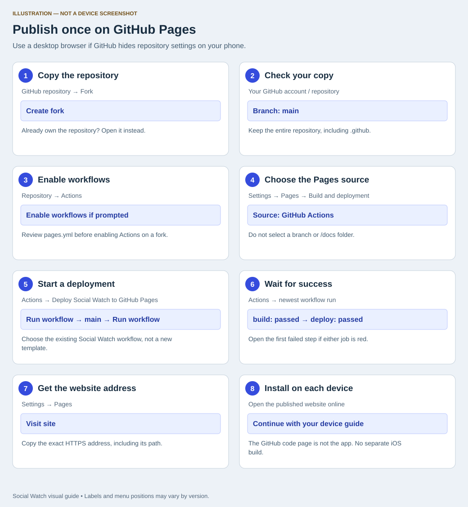

1. **Fork** the repository, or open the existing copy you own.
2. Check the owner and `main` branch; keep the whole source repository.
3. Open **Actions** and enable workflows if GitHub asks.
4. Open **Settings → Pages** and choose **GitHub Actions** as the source.
5. Open **Actions → Deploy Social Watch to GitHub Pages → Run workflow**;
   choose `main` and run it. Do not create another workflow from a suggested template.
6. Open the run and wait for both **build** and **deploy** to succeed.
7. Use **Settings → Pages → Visit site** and copy the exact HTTPS address.
8. Open that address online on each device, then install as below.

See the [full novice instructions](../README.md#first-time-setup-step-by-step)
for repository links, private-repository cautions and troubleshooting.
Never put credentials or an app secret in the repository.

## 2. Install on Windows

### Microsoft Edge

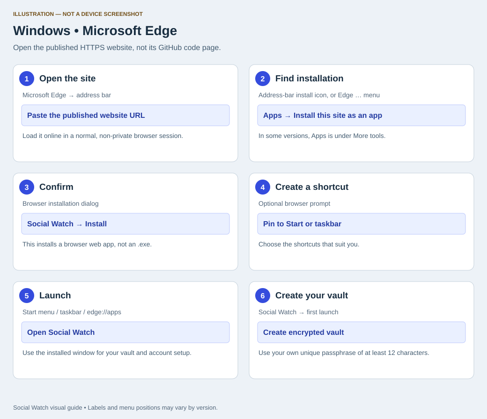

Follow the panels in order: open the live site → **Install** icon or
**… → Apps → Install this site as an app** → confirm **Install** → optional
pinning → open the shortcut → create your vault.

### Google Chrome on Windows or Mac

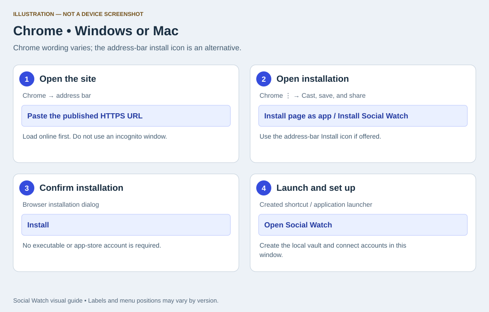

Open the site → use the address-bar install icon or **⋮ → Cast, save, and
share → Install page as app** / **Install Social Watch** → confirm
**Install** → launch the shortcut. Names vary with browser versions.

[Full Windows instructions](../README.md#install-on-windows).

## 3. Install on macOS

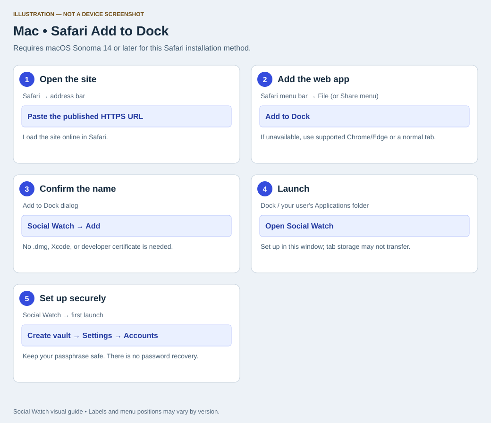

On macOS Sonoma 14 or later: open the site in **Safari** →
**File → Add to Dock** (or **Share → Add to Dock**) → name it
**Social Watch** → **Add** → launch from the Dock → create the vault there.
Safari's web-app storage may differ from its ordinary tab storage.

For Chrome, use the Chrome diagram above. Edge also offers browser-app installation.
[Full Mac instructions](../README.md#install-on-macos).

## 4. Install on iPhone or iPad

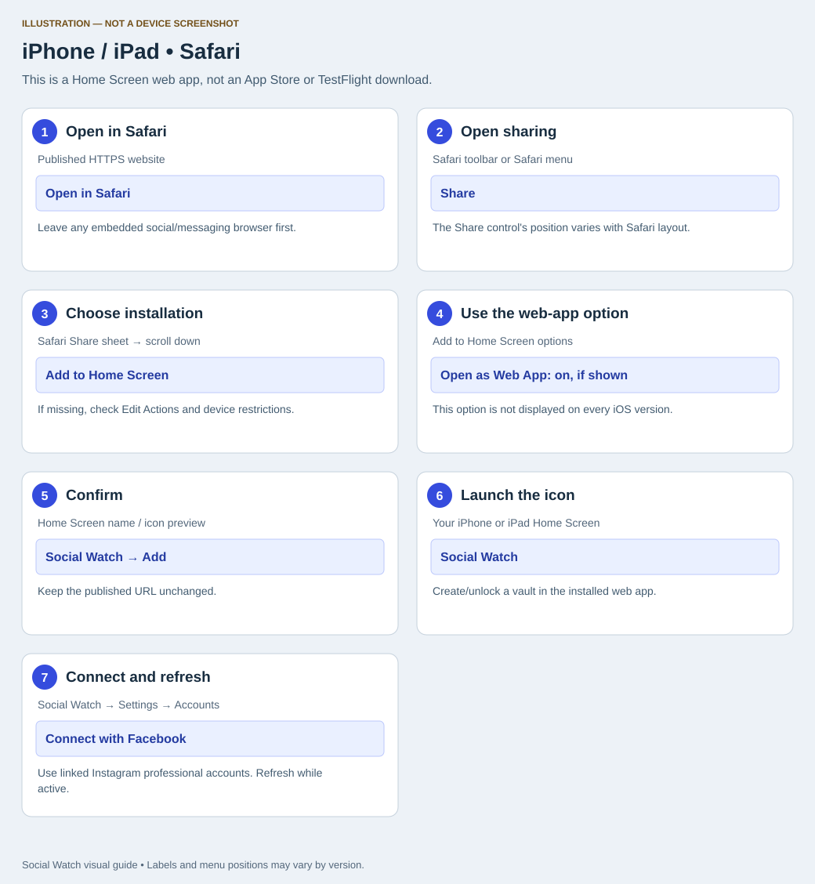

Open the live site directly in **Safari** → **Share** →
**Add to Home Screen** → enable **Open as Web App** if shown →
**Add** → open the new icon → create/unlock the vault and connect accounts.
If the link opens inside another app, switch to Safari first.

This is not an App Store download. Installing it does **not** make closed-app
monitoring or reliable background push available.
[Full iPhone/iPad instructions](../README.md#install-on-iphone-or-ipad).

## 5. First launch: create the vault

**Real app screenshot: first-run form, before any data is entered.**

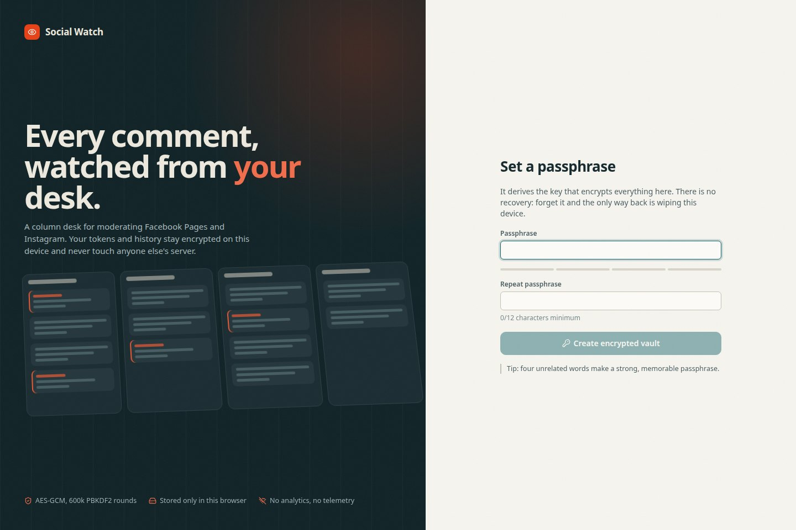

Choose your own unique passphrase of at least **12 characters**, repeat it,
then select **Create encrypted vault**. The passphrase cannot be reset.
Do not reuse a sample phrase from documentation.

**Real app screenshot: a new, empty desk.**

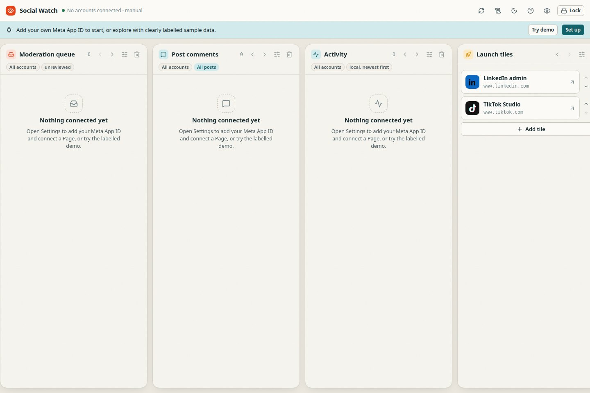

Seeing **No accounts connected** and empty columns is normal. Select
**Try demo** to explore safely, or **Set up** to begin configuring live accounts.
There is no automatic login or sample account password.

## 6. What a multi-platform desk looks like

**Real app screenshot with fictional demo data: Facebook and Instagram together.**

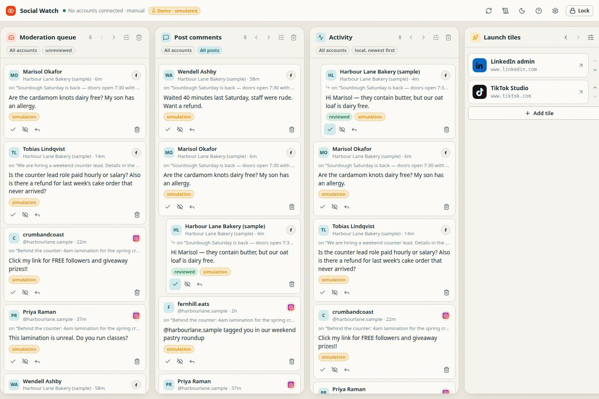

| Area | What to expect |
| --- | --- |
| **Moderation queue** | Unreviewed comments; Facebook and Instagram brand marks identify the Page or linked professional account behind each comment. |
| **Post comments** | Comments for all posts, or a selected account/post. |
| **Activity** | A local, newest-first view of available comments, not a separate social-platform activity feed. |
| **Review / hide / reply / delete** | Review is local. Live hide, reply and delete use the connected account's permissions; demo actions are simulated only. |
| **Launch tiles** | LinkedIn and TikTok brand marks identify shortcuts to other sites. The tiles do not import those platforms' comments or sign you in automatically. |

The header still says **No accounts connected** because demo accounts are
in-memory samples, not authenticated Meta accounts. Real content requires your
own developer app, eligible accounts, permissions and a refresh.
Facebook and Instagram marks also appear beside account names and their
notification settings; LinkedIn and TikTok marks appear on the launch-only tiles.

### Compose a reply

**Real app screenshot: an unsent reply to a fictional Facebook comment.**

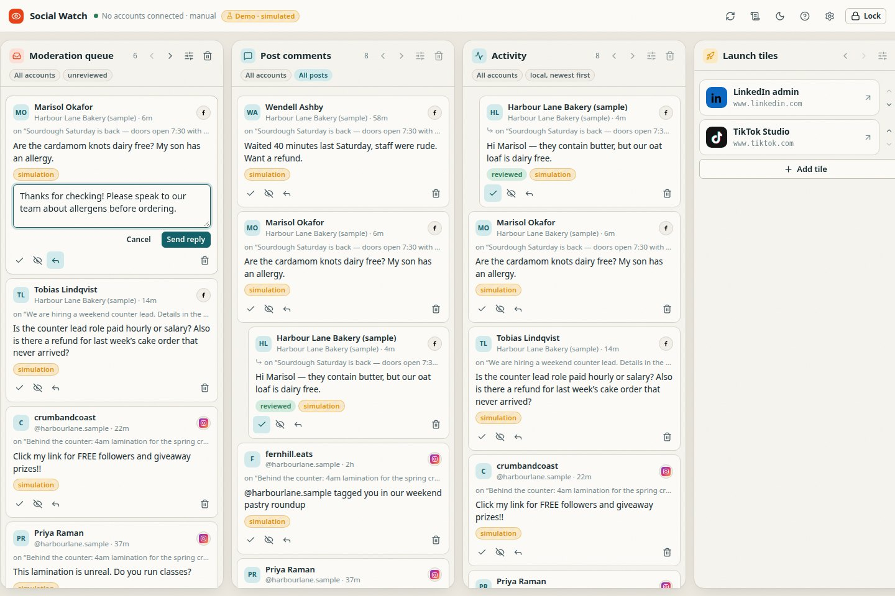

Select a comment's reply arrow, type a response and select **Send reply**.
In this screenshot the reply is **not sent**. In demo mode sending is a local
simulation; with a live account it is a public platform action. Review the text
before submitting. Hiding can be reversed where supported; deleting is permanent
and requires confirmation.

### Highlight watchlist terms across both supported platforms

**Real app screenshot: fictional Facebook and Instagram comments with matches.**

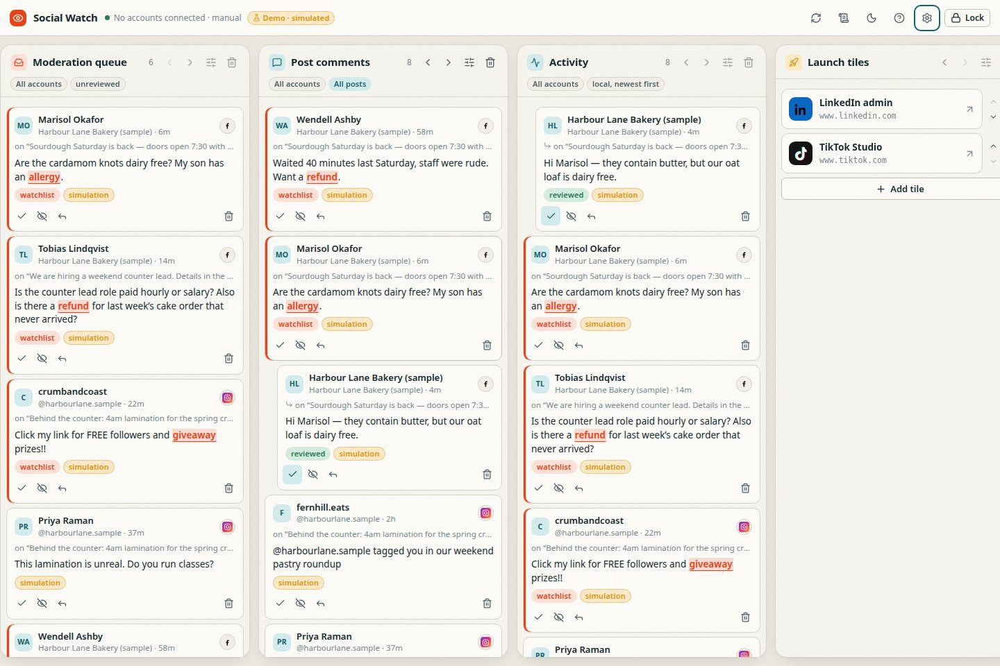

Open **Settings → Watchlist**, add terms such as `allergy`, `refund` or
`giveaway`, then close Settings. A match highlights text; it is not an automatic
spam verdict and does not automatically hide or delete anything.

### Phone-sized layout

**Real app screenshot at 390 × 844: responsive layout, not a native iOS capture.**

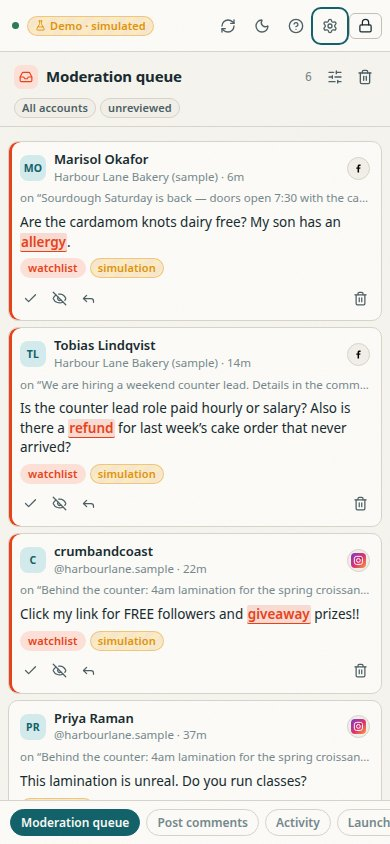

The columns become horizontally navigable on smaller screens. Swipe the deck or
use the column labels at the bottom. This viewport demonstrates layout only:
browser/OS controls and installation prompts are not included.

### LinkedIn and TikTok are links, not imported feeds

**Real app screenshot: the launch-tiles column.**

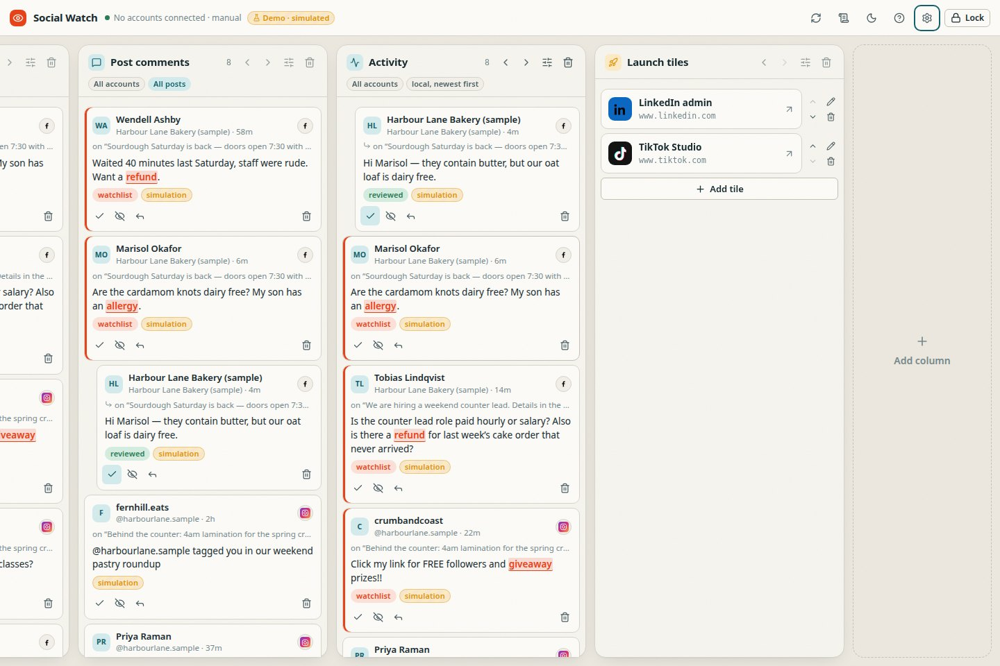

These tiles open the relevant platform in another tab/window. They do **not**
provide LinkedIn/TikTok moderation, account discovery, background monitoring or
Social Watch alerts. The default tiles are generic destinations; configure your
own HTTPS admin links if appropriate. The bakery's sample feeds cover only
Facebook and Instagram.

## 7. Set up real accounts separately

**Real app screenshot: Settings → General, with no real App ID entered.**

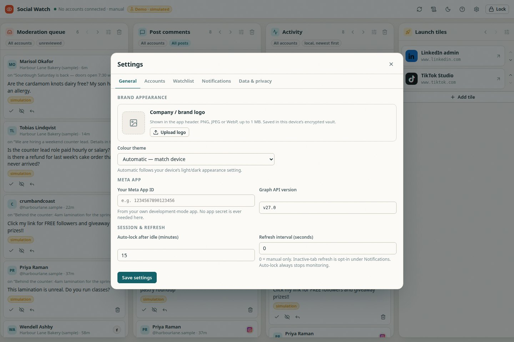

Social Watch can show a custom company/brand image in its header. In General
settings, upload a PNG, JPEG or WebP image no larger than 1 MB. It is stored
inside this device's encrypted vault and included in the encrypted settings-only
profile export. Choose **Remove** to return to the Social Watch mark. The app name
stays “Social Watch.” Because the image is encrypted, it appears in the unlocked
app header, not on the pre-unlock gate.

Choose **Automatic — match device**, **Light**, or **Dark** under **Colour theme**.
Automatic follows the operating system appearance while the app is open; manual
choices remain selected when the device theme changes. The header moon/sun button
switches directly to the other manual mode. The mode is saved with the encrypted
profile and transferred with other settings.

**Real app screenshot: dark appearance selected manually.**

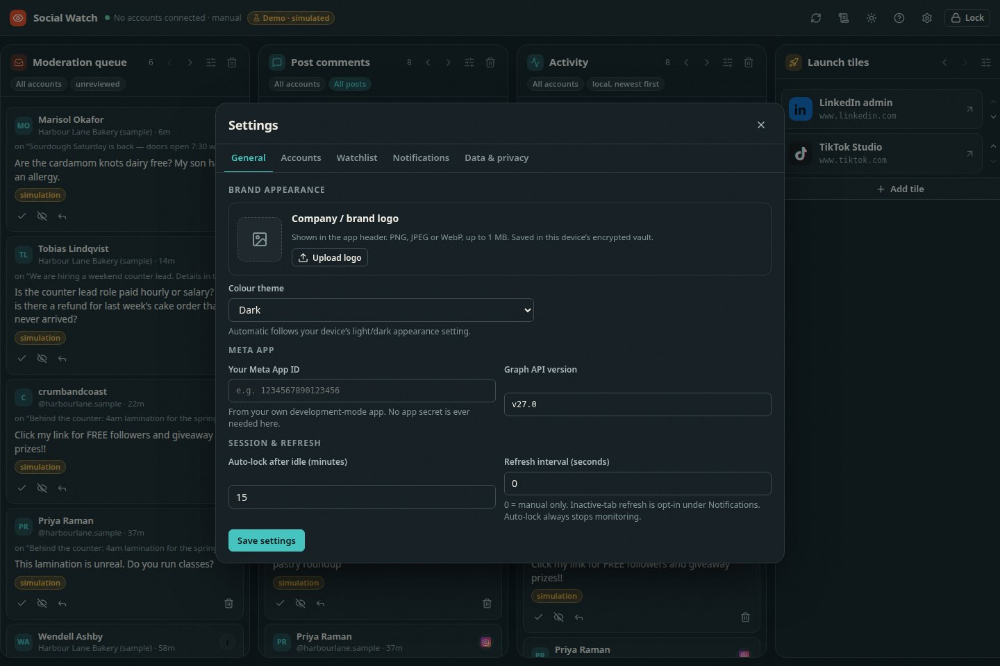

Create your own eligible Meta developer app and register the exact published URL
as its redirect URI. Enter the **App ID**, not the app secret. Leave refresh
manual initially if you are still setting things up.

**Real app screenshot: Settings → Accounts before connection.**

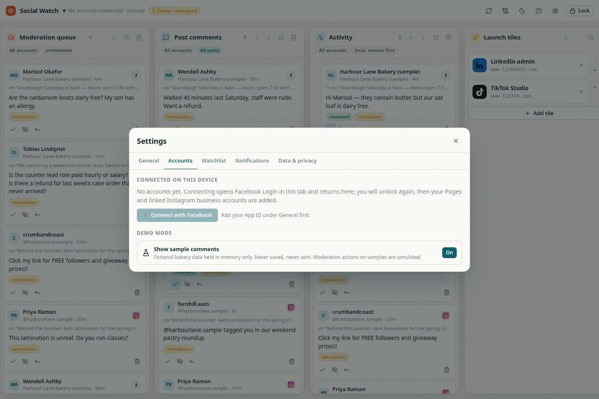

After saving your App ID in General, return to Accounts and choose
**Connect with Facebook**. Follow Meta's real login and permission prompts,
return to Social Watch and unlock again. Refresh to retrieve posts/comments.
Demo identities will never appear here as authenticated accounts.

Meta's login screens are not illustrated as completed sign-ins: they vary by app,
account role and granted permissions. Follow the
[Meta setup and permission instructions](../artifacts/social-watch/README.md#create-your-own-meta-developer-app).
Instagram must be a professional account linked to an eligible Facebook Page.
Review/access requirements apply for users outside your own developer-app roles.

## 8. Notifications: understand the limits before opting in

**Real app screenshot: notification settings before any real account connection.**

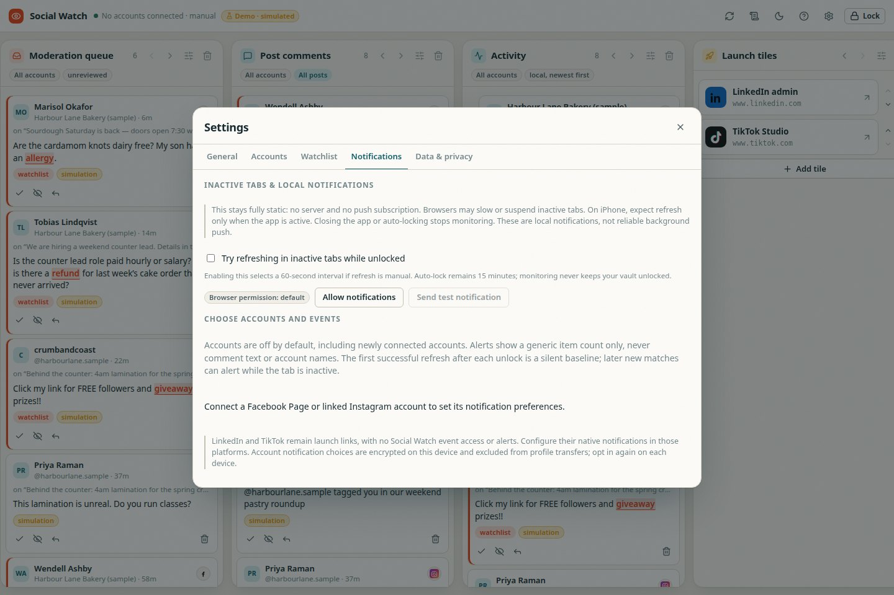

The account toggles are absent in this demo capture because it has **no live
accounts**. After connecting, choose separately for each Facebook/Instagram
account whether to allow new-comment alerts, new-reply alerts and watchlist-only
alerts. Grant browser permission separately; all choices start off.

These are local notifications following a successful refresh, not a server push
service. Inactive desktop tabs may refresh on a best-effort basis while unlocked.
Auto-lock stops monitoring. Closed or suspended pages cannot discover new
comments, and iPhone/iPad should be treated as active-only refresh.
LinkedIn/TikTok alerts must be configured in those platforms, not here.

[Full notification instructions](../README.md#notification-setup).

## Capture provenance and maintenance

App screenshots were captured from the existing interface using normal
create-vault, Try demo and Settings controls. No production demo route, real
credential, external login or vault bypass was added. The capture browser's
disposable storage was discarded afterwards. No live API calls or actual OS
notification delivery were demonstrated.

Maintainers can reproduce the captures with the development workflow running:

```sh
node docs/scripts/capture-app.cjs
python docs/scripts/installation-illustrations.py
```

The capture script uses the project's existing Playwright package and a local
Chromium executable (override `CHROMIUM_PATH` if needed). `DOCS_BASE_URL` can
point to a local development server. Diagrams are small, text-based SVGs so their
labels can be updated when installation steps change.
